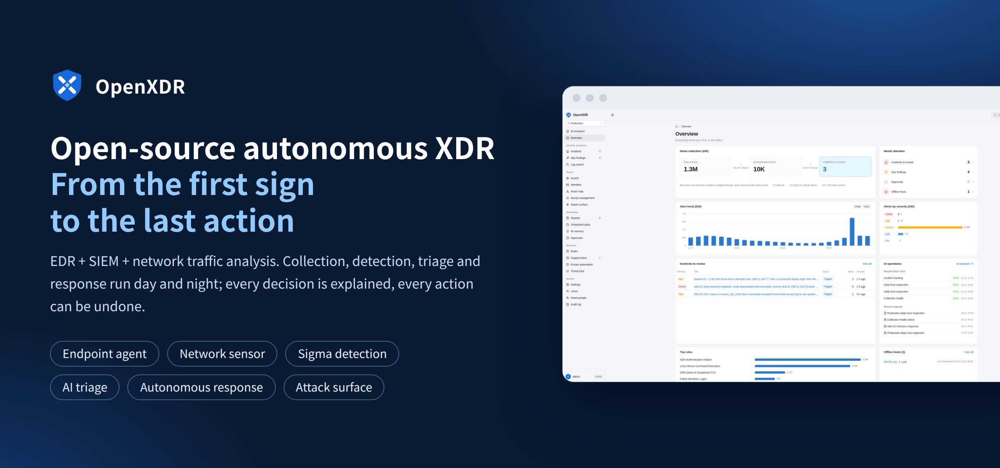
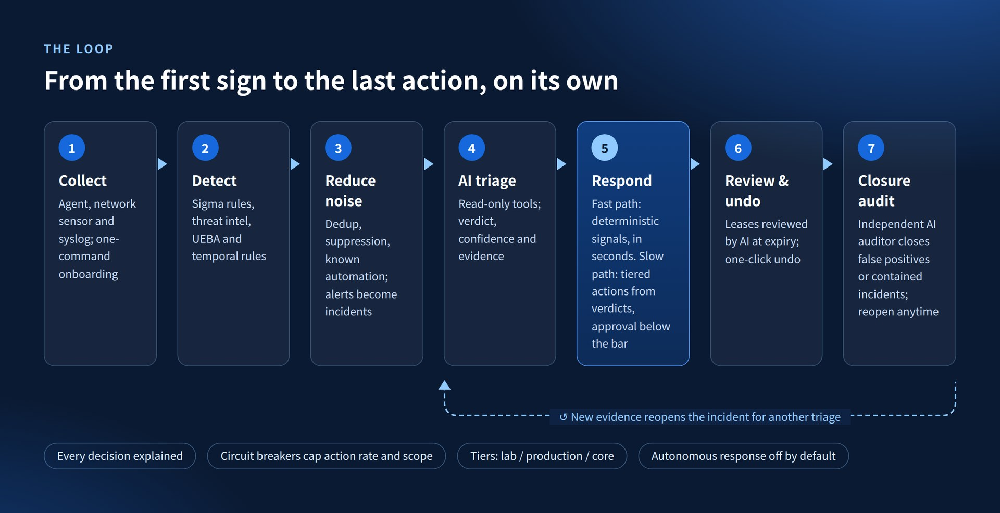
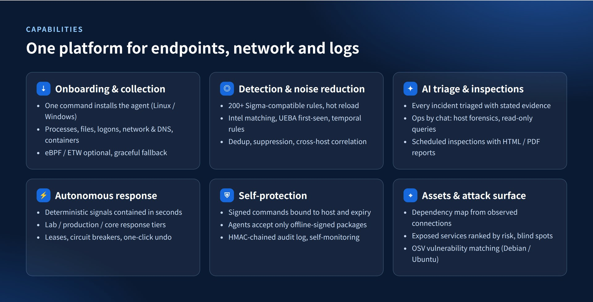
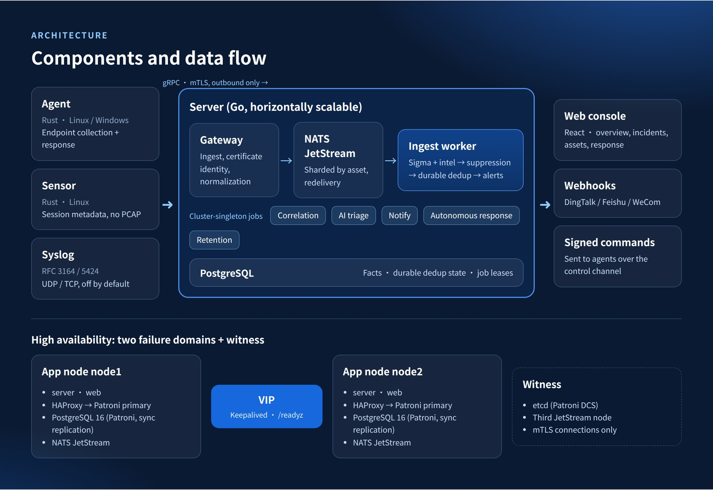
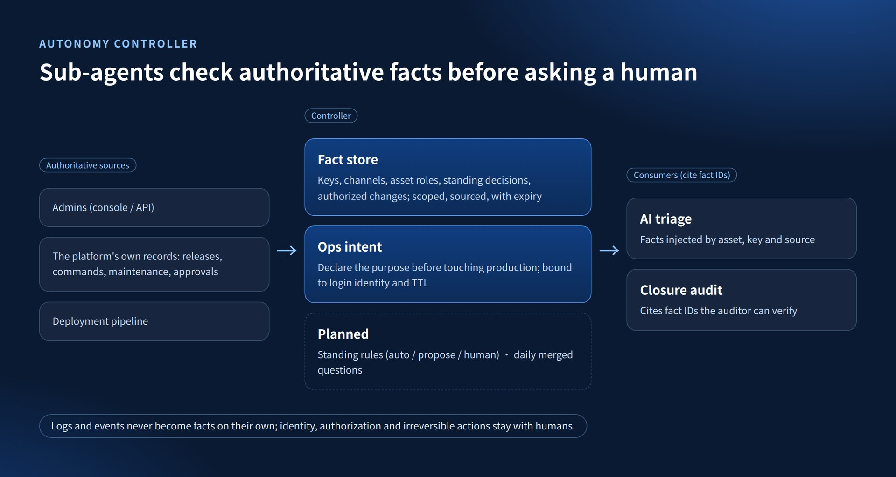

<p align="center"></p>

<p align="center">
  <a href="https://github.com/yaklang/OpenXDR/actions/workflows/ci.yml"></a>
  <a href="LICENSE"></a>
  <br>
  <a href="README.md">中文</a> | English
</p>

<h3 align="center">An open-source autonomous XDR: EDR + SIEM + network traffic analysis</h3>
<p align="center"><b>From the first sign to the last action, it walks the whole way on its own. You review — or overrule.</b></p>

> Detailed documentation under `docs/` is currently written in Chinese.

## From the first sign to the last action

<p align="center"></p>

Deterministic signals are contained in seconds, verdicts drive tiered actions; every decision is explained and every action can be undone.
See [autonomous response and self-protection](docs/autonomous-response-design.md), [detection pipeline](docs/detection.md) and [closing contained incidents](docs/contained-incident-closure.md).

## Capabilities

<p align="center"></p>

| Capability | Docs |
|---|---|
| Onboarding & collection | [Collection](docs/collection.md) · [Document import and host enrollment](docs/host-enrollment.md) |
| Detection & noise reduction | [Detection](docs/detection.md) · [Temporal detection](docs/temporal-detection.md) · [Cross-host correlation](docs/attack-campaign-design.md) |
| AI triage & inspections | [AI assistant and inspections](docs/pi-backend.md) · [AI-native architecture](docs/ai-native.md) |
| Autonomous response & self-protection | [Autonomous response and self-protection](docs/autonomous-response-design.md) |
| Assets, attack surface & vulnerabilities | [Asset map and attack surface](docs/asset-map.md) · [Software vulnerabilities](docs/vulns.md) |

## Architecture

<p align="center"></p>

See [architecture](docs/architecture.md), [high availability](deploy/ha/README.md) and [cluster and observability](docs/cluster.md).

## Autonomy controller

<p align="center"></p>

See [autonomy controller design](docs/autonomy-controller-design.md).

## Screenshots

<sub>These screenshots come from a fictional demo environment; all hosts, addresses and domains are examples.</sub>

<p align="center"></p>

<table>
<tr>
<td width="50%" valign="top"><br><b>AI assistant handling an incident</b></td>
<td width="50%" valign="top"><br><b>Incident detail</b></td>
</tr>
<tr>
<td width="50%" valign="top"><br><b>Asset map</b></td>
<td width="50%" valign="top"><br><b>Attack surface</b></td>
</tr>
</table>

## Install

A Linux server with Docker:

```bash
curl -fsSL https://github.com/yaklang/OpenXDR/releases/latest/download/install.sh | sudo sh -s -- <console domain or IP>
```

Or send this to your AI agent (Claude Code, Codex, Cursor, … running on the target server):

```text
Install OpenXDR on this server, strictly following https://github.com/yaklang/OpenXDR/blob/master/docs/install.md:
check the environment first and ask me which domain or IP the console should use, then install, and finally tell me the console URL, the admin password, and the command for enrolled hosts to trust the CA.
```

See [install](docs/install.md) and [deployment guide](docs/deployment.md); the full index is [docs/README.md](docs/README.md).

## Status

v0.4.0. The maintainers run it in their own network as a two-node high-availability deployment, covering twenty-odd Linux and Windows hosts.
Autonomous response is off by default; the quality of AI verdicts depends on the model you connect, and the platform keeps it within permission, allowlist and approval boundaries.
Known gaps are in the [roadmap](docs/roadmap.md); changes per release are in the [CHANGELOG](CHANGELOG.md).

## Contributing and license

Issues and PRs are welcome; please read [CONTRIBUTING.md](CONTRIBUTING.md) first, and report security issues privately as described in [SECURITY.md](SECURITY.md).

[Apache License 2.0](LICENSE). Third-party data: `rules/sigmahq/` holds SigmaHQ community rules (DRL 1.1, see its README); the offline IP geolocation database shipped in release images is
[DB-IP Lite](https://db-ip.com) (IP Geolocation by DB-IP, CC BY 4.0), see [asset map](docs/asset-map.md#离线归属库).
