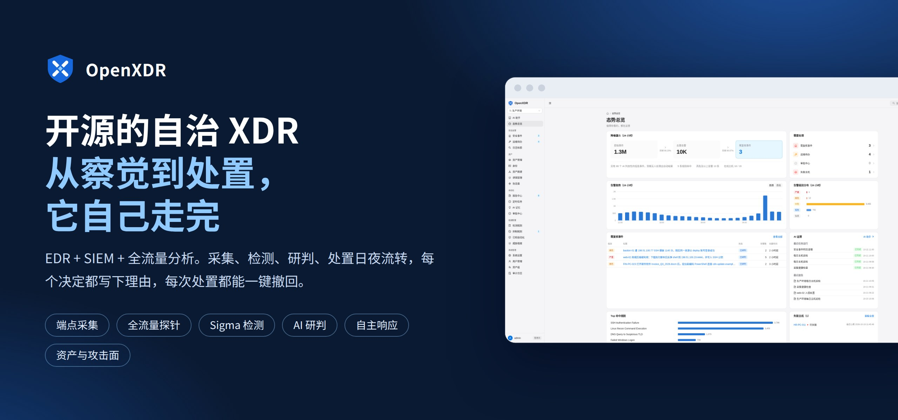
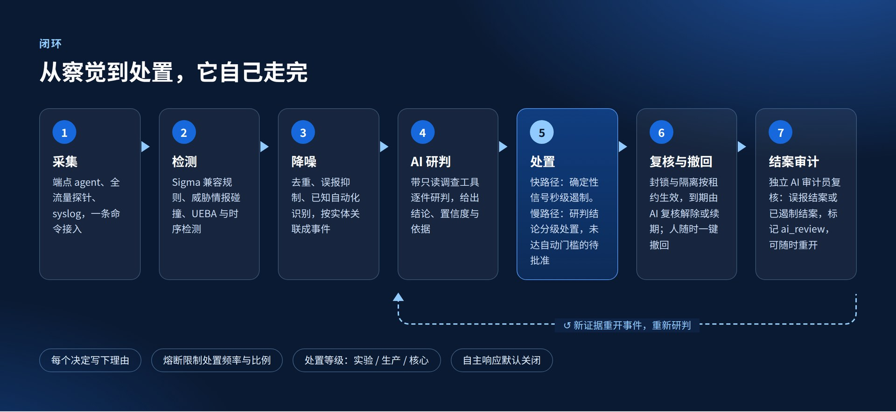
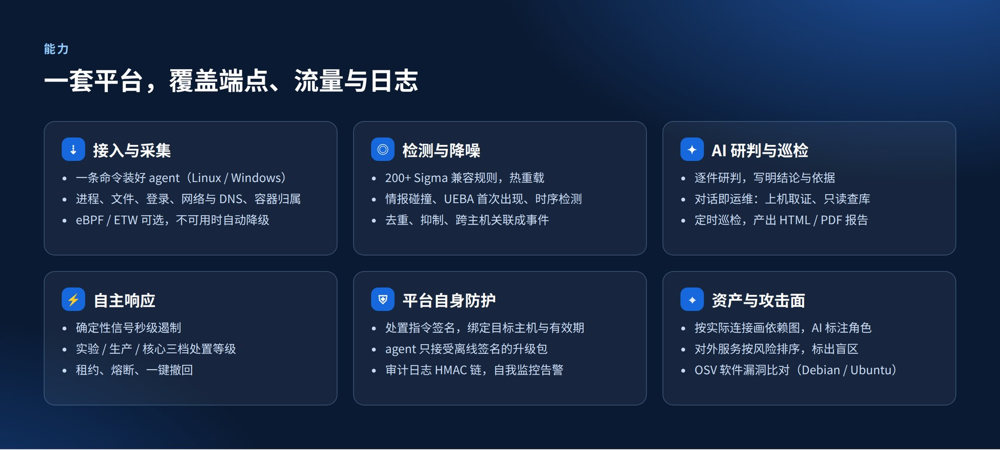
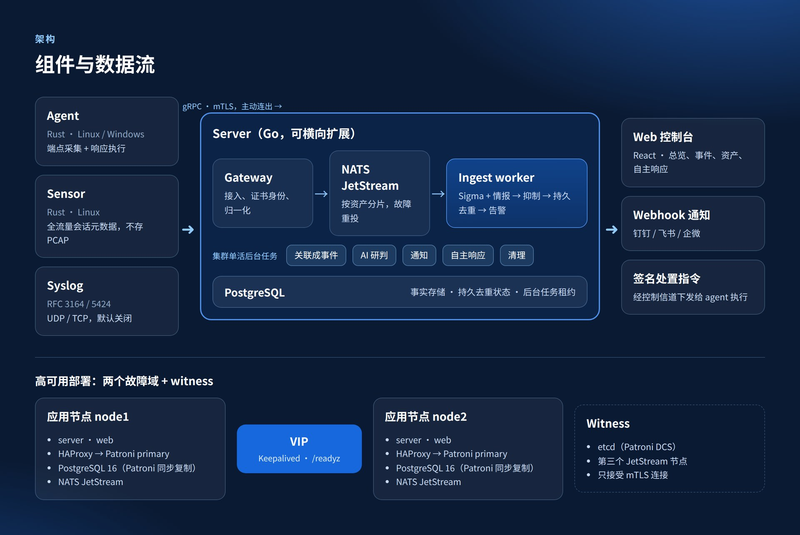
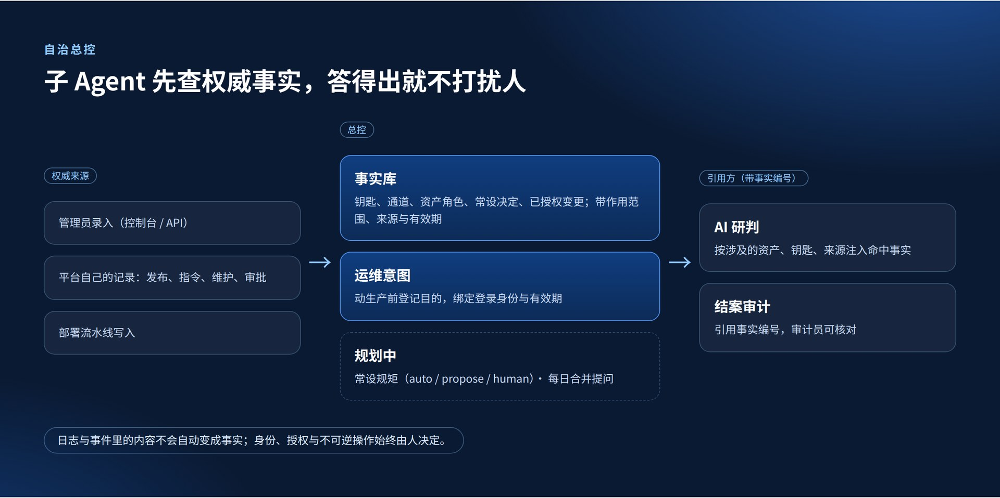

<p align="center"></p>

<p align="center">
  <a href="https://github.com/yaklang/OpenXDR/actions/workflows/ci.yml"></a>
  <a href="LICENSE"></a>
  <br>
  中文 | <a href="README.en.md">English</a>
</p>

<h3 align="center">开源的自治 XDR：EDR + SIEM + 全流量分析</h3>
<p align="center"><b>从察觉到处置，它自己走完；你只需审阅，或者推翻。</b></p>

## 从察觉到处置

<p align="center"></p>

确定性信号秒级遏制，研判结论分级处置；每个决定写下理由，每次处置都能撤回。
详见 [自主响应与自身防护](docs/autonomous-response-design.md)、[检测链路](docs/detection.md)、[已遏制事件自动结案](docs/contained-incident-closure.md)。

## 能力

<p align="center"></p>

| 能力 | 文档 |
|---|---|
| 接入与采集 | [采集端](docs/collection.md) · [文档导入与主机纳管](docs/host-enrollment.md) |
| 检测与降噪 | [检测链路](docs/detection.md) · [时序检测](docs/temporal-detection.md) · [跨主机关联](docs/attack-campaign-design.md) |
| AI 研判与巡检 | [AI 助手与巡检](docs/pi-backend.md) · [AI 原生架构](docs/ai-native.md) |
| 自主响应与自身防护 | [自主响应与自身防护](docs/autonomous-response-design.md) |
| 资产、攻击面与漏洞 | [资产图谱与攻击面](docs/asset-map.md) · [软件漏洞](docs/vulns.md) |

## 架构

<p align="center"></p>

详见 [架构](docs/architecture.md)、[高可用部署](deploy/ha/README.md)、[集群与可观测性](docs/cluster.md)。

## 自治总控

<p align="center"></p>

详见 [自治总控设计](docs/autonomy-controller-design.md)。

## 界面一览

<sub>截图来自虚构的演示环境，主机、地址与域名均为示例。</sub>

<p align="center"></p>

<table>
<tr>
<td width="50%" valign="top"><br><b>AI 助手处理事件</b></td>
<td width="50%" valign="top"><br><b>事件详情</b></td>
</tr>
<tr>
<td width="50%" valign="top"><br><b>资产图谱</b></td>
<td width="50%" valign="top"><br><b>攻击面</b></td>
</tr>
</table>

## 安装

一台装了 Docker 的 Linux 服务器：

```bash
curl -fsSL https://github.com/yaklang/OpenXDR/releases/latest/download/install.sh | sudo sh -s -- <控制台域名或 IP>
```

或者把这句话发给你的 AI agent（Claude Code、Codex、Cursor 等，在目标服务器上运行）：

```text
请在这台服务器上安装 OpenXDR，严格按照 https://github.com/yaklang/OpenXDR/blob/master/docs/install.md 操作：
先检查环境并问我控制台用哪个域名或 IP，再执行安装，最后把控制台地址、admin 口令，以及被纳管主机信任 CA 的命令告诉我。
```

详见 [安装](docs/install.md) 与 [部署与使用手册](docs/deployment.md)；完整文档索引见 [docs/README.md](docs/README.md)。

## 当前状态

v0.4.0。维护团队自己的内网以双节点高可用部署持续运行，纳管二十多台 Linux 与 Windows 主机。
自主响应默认关闭；AI 结论的质量取决于所接模型，平台保证它越不过权限、名单与审批的边界。
已知缺口见 [路线图](docs/roadmap.md)，版本变化见 [CHANGELOG](CHANGELOG.md)。

## 参与与许可

欢迎 Issue 与 PR，提交前请读 [CONTRIBUTING.md](CONTRIBUTING.md)；安全问题请按 [SECURITY.md](SECURITY.md) 私下报告。

[Apache License 2.0](LICENSE)。第三方数据：`rules/sigmahq/` 为 SigmaHQ 社区规则（DRL 1.1，见其 README）；发版镜像自带的离线 IP 归属库为
[DB-IP Lite](https://db-ip.com)（IP Geolocation by DB-IP，CC BY 4.0），见 [资产图谱](docs/asset-map.md#离线归属库)。
